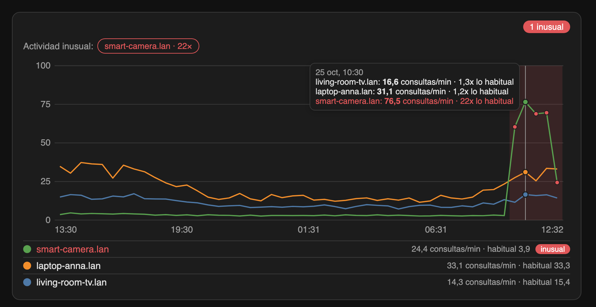
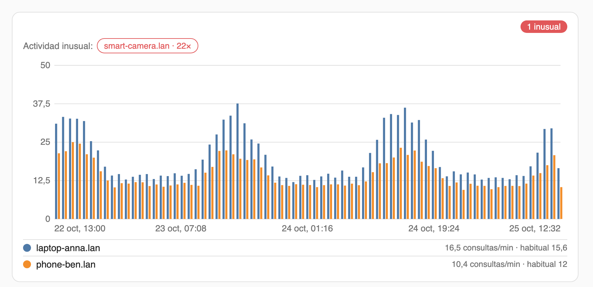

# Pi-hole Extended

[](https://my.home-assistant.io/redirect/hacs_repository/?owner=Andresako&repository=pi-hole-extended&category=integration)

[](https://github.com/Andresako/pi-hole-extended/releases/latest) [](https://github.com/andresako/pi-hole-extended/actions/workflows/hacs.yaml) [](https://github.com/andresako/pi-hole-extended/actions/workflows/hassfest.yaml)

**Descubre qué dispositivo de tu red habla con Pi-hole y cuándo uno se vuelve loco.** Pi-hole Extended convierte las consultas que informa Pi-hole v6 en contadores por dispositivo, una gráfica de actividad para tus paneles y sensores sobre los que puedes automatizar.



> Integración personalizada creada por la comunidad. No está afiliada ni respaldada por Home Assistant ni por Pi-hole.

## Características

- **Un dispositivo de Home Assistant por cliente** que ve Pi-hole, con contadores de consultas DNS y desglose en permitidas, bloqueadas y provisionales.
- **Tarjeta de actividad** para graficar uno o varios dispositivos en bloques de 5 minutos a 1 día durante hasta 30 días, como líneas o barras. Todo se ajusta desde el editor de la tarjeta.
- **Vista por dispositivo** (`custom:phe-device`) que muestra un dispositivo como un pulso en vivo: indicador de ritmo, rango habitual, anillo de permitidas y bloqueadas y una cinta de 60 segundos. Ver [ejemplos de panel](docs/dashboard-examples.md#una-vista-por-dispositivo).
- **Detección de actividad inusual**: un dispositivo que se mantiene muy por encima de su propia tasa habitual se resalta en la gráfica y activa un sensor binario que puedes usar en automatizaciones.
- **Diagnóstico** de la conexión, la última lectura, la última consulta vista y la cobertura de ingesta.
- **Respetuosa con la privacidad**: la integración solo conserva contadores, y la tarjeta y los sensores usan recuentos agregados, nunca dominios. Las entradas opcionales de Activity sí incluyen el dominio consultado; elige *Solo totales* para desactivarlas.
- Independiente de la integración de Pi-hole incluida en Home Assistant.

## Requisitos

- Home Assistant **2025.1 o posterior**, con el Recorder activado (lo está por defecto).
- Pi-hole **v6**. El contrato de la API de consultas está comprobado con FTL **6.1.0–6.8.x**; cada Pi-hole sirve su referencia de API en `/api/docs`.

## Instalación

### HACS (recomendada)

1. Pulsa el botón de arriba o, en HACS, abre **⋮ → Repositorios personalizados**, añade `https://github.com/Andresako/pi-hole-extended` y elige **Integración**.
2. Instala **Pi-hole Extended** y reinicia Home Assistant.
3. Abre **Ajustes → Dispositivos y servicios → Añadir integración**, busca **Pi-hole Extended** y sigue el formulario.

### Manual

Descarga la última versión desde la [página de versiones](https://github.com/Andresako/pi-hole-extended/releases/latest), copia `custom_components/pihole_queries` en el directorio de configuración de Home Assistant y reinicia.

## Configuración

Crea una contraseña de aplicación en la interfaz web de Pi-hole, en **Settings**; Pi-hole la muestra una sola vez ([guía de autenticación](https://docs.pi-hole.net/api/auth/)). Después introduce:

| Campo | Descripción |
|---|---|
| Host o dirección IP | Sin protocolo, puerto ni ruta. |
| Puerto web/API | Se usa tal como lo escribes. |
| Usar HTTPS / Verificar certificado | Desactiva la verificación solo con un certificado autofirmado. |
| Contraseña de aplicación | Se guarda en la entrada de la integración y nunca se escribe en los registros. |
| Frecuencia de consulta | 1–3600 segundos (15 por defecto). Intervalos cortos muestran antes las consultas nuevas y hacen más peticiones a la API. |

### Opciones

Abre la integración y elige **Configurar**:

| Opción | Valores | Efecto |
|---|---|---|
| Frecuencia de consulta | 1–3600 s | Cada cuánto se lee Pi-hole. |
| Política de Activity | Activity habilitada · Solo totales | Si las consultas nuevas se envían a Activity de Home Assistant. *Solo totales* no envía ninguna. |
| Eventos de Activity | Todos · Solo bloqueados · Ninguno | Qué consultas nuevas aparecen en Activity. Los contadores nunca se filtran. |
| Aviso de actividad inusual | Desactivado · Baja · Media · Alta | Sensibilidad de la tarjeta y de los sensores binarios. *Desactivado* no crea sensores. Por defecto: Media. |

Usa **Reconfigurar** para cambiar la dirección o las credenciales; elige *Es el mismo Pi-hole* para conservar contadores e identidad, o *Es un Pi-hole de reemplazo* cuando el servidor se ha sustituido.

## Entidades

Para cada cliente, agrupadas bajo su propio dispositivo:

| Entidad | Descripción |
|---|---|
| `sensor.phe_<cliente>_consultas_dns` | **Consultas DNS**: consultas observadas, acumuladas. |
| `sensor.phe_<cliente>_consultas_en_el_ultimo_minuto` | **Consultas (último minuto)**: recuento móvil según la hora de la consulta en Pi-hole. |
| `sensor.phe_<cliente>_permitidas_v1` | **Consultas permitidas**, acumuladas. |
| `sensor.phe_<cliente>_bloqueadas_v1` | **Consultas bloqueadas**, acumuladas. |
| `sensor.phe_<cliente>_provisionales_v1` | **Consultas provisionales**: resultado aún no reconocido. |
| `binary_sensor.phe_<cliente>_actividad_inusual` | **Actividad inusual**, ver más abajo. |

Por cada entrada de Pi-hole, cuatro sensores de diagnóstico: **Estado de comunicación**, **Última lectura correcta**, **Última consulta observada** y **Cobertura de ingesta**. `<cliente>` es la dirección del cliente con guiones bajos, por ejemplo `192_0_2_21`; el registro de entidades muestra los ID exactos.

La integración cuenta las consultas que observa mientras sondea. No recupera lo que Pi-hole atendió antes de la configuración.

## Tarjeta de actividad

La tarjeta se carga sola. Añádela a un panel con **Editar panel → Añadir tarjeta → Actividad de Pi-hole Extended**, o pégala como tarjeta manual:

```yaml
type: custom:phe-activity-card
```



Elige los dispositivos, el tamaño de bloque, el rango, el tipo de gráfica y el resto de ajustes en el editor de la tarjeta. Se guardan en el panel, así que todos ven la misma gráfica. Sin dispositivos elegidos, la tarjeta muestra los tres más activos. También puedes escribir las opciones en YAML:

```yaml
type: custom:phe-activity-card
title: Actividad de la red
entities:
  - sensor.phe_192_0_2_21_consultas_dns
  - sensor.phe_192_0_2_34_consultas_dns
bucket: 30m
span: 1d
chart_type: bar
log_scale: false
show_overview: true
names:
  sensor.phe_192_0_2_21_consultas_dns: TV del salón
```

| Opción | Valores | Por defecto |
|---|---|---|
| `entities` | Hasta 12 contadores **Consultas DNS** | Los tres más activos |
| `bucket` | `5m` `15m` `30m` `1h` `3h` `6h` `1d` | `30m` |
| `span` | `6h` `12h` `1d` `3d` `7d` `14d` `30d` | `1d` |
| `chart_type` | `line` · `bar` | `line` |
| `log_scale` | `true` · `false` | `false` |
| `show_overview` | Avisar de dispositivos inusuales, incluidos los que no están en la gráfica | `true` |
| `title` | Encabezado opcional | ninguno |
| `names` | `{entity_id: etiqueta}` | el nombre del cliente |

En la leyenda, pulsa el círculo de color de un dispositivo para ocultarlo o mostrarlo, o su nombre para abrir el historial de Home Assistant de ese sensor. Al pasar el ratón por la gráfica verás un cursor y un tooltip con la tasa de cada dispositivo y cómo se compara con su nivel habitual.

La tarjeta lee las estadísticas a largo plazo de Home Assistant, así que el eje de tiempo es el momento en que Home Assistant recibió el dato. Los bloques de menos de una hora están disponibles para rangos de hasta 10 días, el valor por defecto del Recorder para estadísticas de 5 minutos.

## Actividad inusual

Un dispositivo es **inusual** cuando se mantiene muy por encima de su propio patrón reciente: varias veces su nivel habitual, por encima de su pico diario típico y de una tasa mínima, durante al menos 15 minutos. Los dispositivos tranquilos o con ráfagas regulares no se marcan por su comportamiento normal, y un dispositivo nuevo no tiene referencia hasta que existen 24 bloques de historial (dos horas para los sensores).

Cada dispositivo tiene un sensor binario **Actividad inusual** que está *on* mientras ocurre, *off* en caso contrario y *desconocido* hasta que tiene historial suficiente (24 bloques de 5 minutos). Se evalúa cada 5 minutos, así que reacciona en 10 a 20 minutos. Sus atributos son `current_rate`, `usual_rate`, `threshold`, `times_usual`, `since` y `evaluated_at`.

```yaml
automation:
  - alias: Pi-hole · actividad inusual de un dispositivo
    triggers:
      - trigger: state
        entity_id: binary_sensor.phe_192_0_2_47_actividad_inusual
        to: "on"
        for: "00:10:00"
    actions:
      - action: notify.notify
        data:
          title: Actividad DNS inusual
          message: >-
            {{ trigger.to_state.name }} hace
            {{ trigger.to_state.attributes.current_rate }} consultas/min,
            {{ trigger.to_state.attributes.times_usual }}× lo habitual.
```

Los ejemplos listos para importar de [panel](examples/dashboards/pihole-extended.yaml) y [automatización](examples/automations/unusual-activity-alert.yaml), y cómo adaptarlos, están en la [guía de ejemplos](docs/dashboard-examples.md#ejemplos-de-panel-para-pi-hole-extended).

## Conviene saber

- La tarjeta y los sensores leen estadísticas del Recorder. Si restringes el Recorder con `include`, registra los sensores de cliente:

  ```yaml
  recorder:
    include:
      entity_globs:
        - sensor.phe_*
  ```

- Con Activity habilitada, cada consulta nueva se escribe en **Activity** (registro) de Home Assistant con su cliente, dominio y resultado. Que se conserve depende de tus filtros del Recorder y de Activity. Elige *Solo totales* si no quieres dominios en el registro.
- Con intervalos de sondeo muy cortos o cientos de clientes, consulta los [detalles técnicos](docs/DETALLES_ES.md) para ver los límites medidos.

## Solución de problemas

- **Los contadores no suben:** revisa **Estado de comunicación**, host, puerto, TLS, la contraseña y si Pi-hole aún conserva la consulta en su historial en memoria.
- **Los contadores suben pero Activity está vacía:** confirma que *Activity habilitada* está elegida, que la opción de eventos permite el resultado y que los filtros de Activity de Home Assistant lo permiten.
- **La tarjeta no aparece o muestra «Custom element doesn't exist»:** reinicia Home Assistant tras instalar o actualizar y recarga el navegador sin caché.
- **La gráfica está vacía:** el cliente necesita estadísticas registradas; espera unos minutos tras la configuración y comprueba que el Recorder incluye `sensor.phe_*`.
- **Los sensores de actividad inusual siguen desconocidos:** un dispositivo necesita al menos 24 bloques de historial registrado (dos horas para los sensores) para tener referencia.

## Soporte

- [Informar de un problema o pedir una mejora](https://github.com/Andresako/pi-hole-extended/issues)
- [Registro de cambios](CHANGELOG.md) · [Detalles técnicos](docs/DETALLES_ES.md) · [Contribuir](CONTRIBUTING.md) · [Política de seguridad](SECURITY.md)
- [Read in English](README.md)

## Licencia

[MIT](LICENSE)
