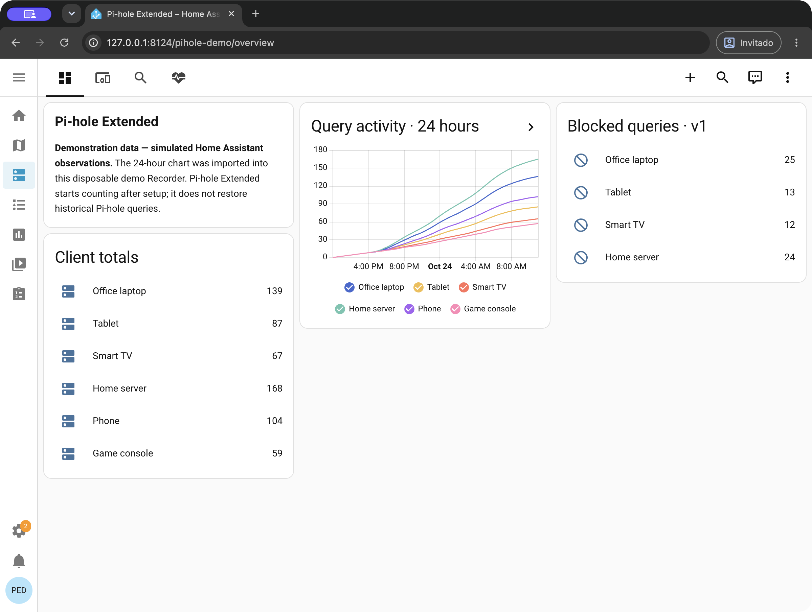
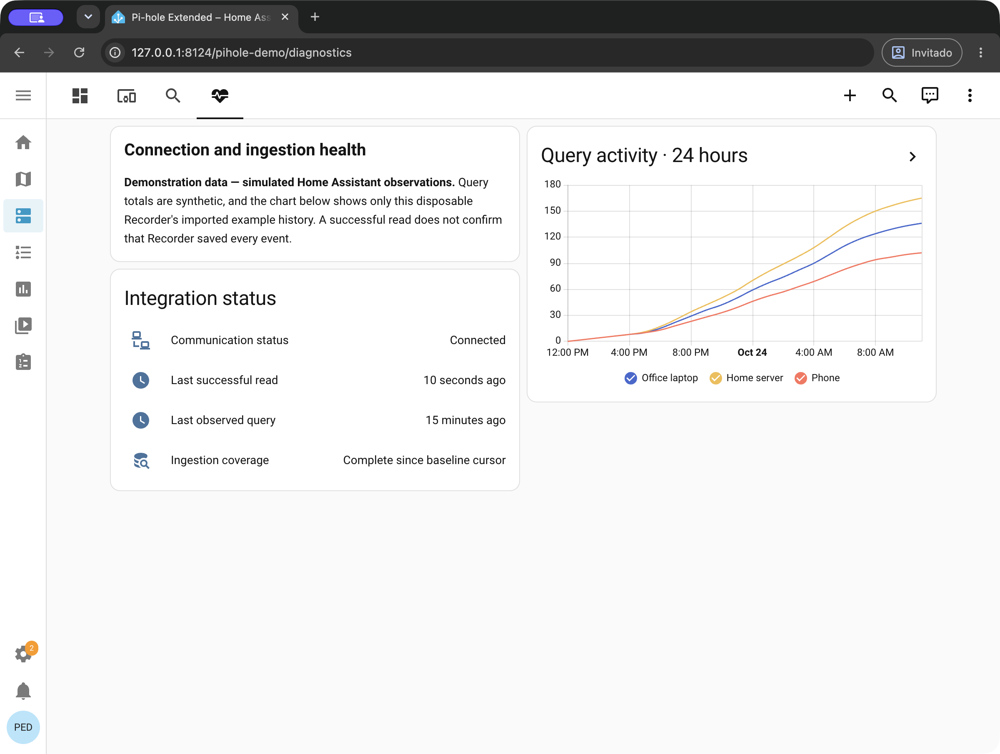

# Pi-hole Extended

**See the DNS activity Pi-hole v6 reports to Home Assistant, organized by client.** Pi-hole Extended adds clear per-client counters, optional recent query details, and diagnostics that help you see whether Home Assistant is keeping up.

> A community-built Home Assistant custom integration. It is not affiliated with or endorsed by Home Assistant or Pi-hole.

  

## At a glance

- One Home Assistant device for each client found in Pi-hole's visible query history.
- Five client sensors: total observed queries, queries in the last minute, allowed, blocked, and provisional. Classifier counts are versioned internally so later changes remain clear.
- Choose **Detailed query history** for recent query details and optional Activity entries, or **Aggregate totals only** to retain client identities and numeric totals without query rows or domains.
- Per-entry diagnostics show communication status, last successful read, last observed query, and ingestion coverage.
- A starter dashboard with four native Home Assistant views, titled **Summary**, **Clients**, **Details**, and **Diagnostics** in the example YAML.

The integration counts new queries it observes while polling Pi-hole. It does not recreate all traffic Pi-hole has ever handled, and its dashboard does not rank queries by their original event time.

## Dashboard previews

The screenshots below show a customized four-view Home Assistant example. Its 24-hour chart uses synthetic observations imported into a disposable Recorder for demonstration; Pi-hole Extended begins counting after setup and does not restore historical Pi-hole queries.

*Demonstration data — simulated Home Assistant observations. Client totals and chart history are synthetic and are shown to demonstrate the dashboard layout.*

*Demonstration data — simulated Home Assistant observations. The chart is example Recorder history, while connection and ingestion values reflect the isolated demo instance.*

## Requirements

- Home Assistant **2025.1 or newer**.
- Pi-hole **v6**. The query API contract is checked against FTL **6.1.0–6.8.x**; your Pi-hole also serves its API reference at `/api/docs`.

## Install with HACS

Pi-hole Extended is installed as a custom HACS repository and is not currently in the HACS default catalog.

1. In Home Assistant, open **HACS → Integrations → ⋮ → Custom repositories**.
2. Add `https://github.com/Andresako/pi-hole-extended` and select **Integration**.
3. Install **Pi-hole Extended**, then restart Home Assistant.
4. Open **Settings → Devices & services → Add integration**, search for **Pi-hole Extended**, and follow the setup form.

For a manual installation, download [`pihole_queries-0.8.0.zip`](https://github.com/Andresako/pi-hole-extended/releases/download/0.8.0/pihole_queries-0.8.0.zip), extract `custom_components/pihole_queries` into your Home Assistant configuration directory, and restart Home Assistant.

## Configure Pi-hole

Create an application password in Pi-hole's web interface under **Settings**. Pi-hole displays the password only once; see the [Pi-hole authentication guide](https://docs.pi-hole.net/api/auth/).

During setup, provide:

- Pi-hole hostname or IP address, without protocol, port, or path.
- Web/API port. The port is used exactly as entered, including with HTTPS.
- Whether to use HTTPS and whether to verify the TLS certificate.
- The application password.
- Poll interval, in seconds (default: **15**).

The password is stored with the Home Assistant integration entry and is not included in integration logs. Start with the default poll interval; shorter intervals can show new observations sooner and make more API requests.

## See your first observations

After setup, wait for a successful poll and check **Communication status** and **Ingestion coverage** in the integration's diagnostic entities. The first read establishes a baseline; it does not count the queries already in Pi-hole's current snapshot. Then make a fresh DNS request from a device that uses this Pi-hole and wait for the next poll.

The client's **DNS queries** counter should increase when the new query is observed. Allowed and blocked queries update their respective classifier counters; unrecognized or incomplete results remain provisional and are excluded from the classified percentage. In Detailed mode, a new query can also appear in Home Assistant's **Activity** when the Activity option permits it. The current Activity event text is in Spanish. Activity and Recorder persistence depends on your Home Assistant configuration.

## Choose what to retain

In the integration's options, choose one of these modes:

- **Detailed query history** (default): retains recent query details for client sensors. Activity can record **All events**, **Blocked events only**, or **No Activity events**.
- **Aggregate totals only**: retains client identities and numeric totals, without query domains, IDs, raw statuses, or individual query rows. It disables new Activity entries.

Changing to Aggregate removes query details from the integration's current Store and legacy copy. It does not erase data already recorded by Home Assistant, existing Activity history, exports, or backups. See [technical details and limits](docs/DETAILS.md) for retention behavior and high-volume considerations.

## Add the example dashboard

The [starter dashboard YAML](examples/dashboards/pihole-extended.yaml) contains four views built from Home Assistant's native cards. It uses placeholder entity IDs: copy the YAML into a new dashboard and map each placeholder to the entity IDs in your own entity registry. Follow the [dashboard guide](docs/dashboard-examples.md); do not replace an existing dashboard's configuration.

## Updating from 0.7.x

Version 0.8.0 retires the two older unversioned allowed/blocked client counters. Home Assistant disables existing registry entries while retaining their IDs, custom names, and Recorder history. Update dashboards and automations that refer to those counters to use **Allowed queries** and **Blocked queries**. New installations create five client entities: DNS queries, Queries (last minute), and three classification counters.

The restored **Queries (last minute)** sensor reuses its original entity identity and Recorder history because it uses the same Pi-hole event-time window. In Aggregate mode, the sensor uses anonymous one-second source-time buckets and can differ by up to one second at the boundary. It stays unavailable when coverage is unknown or partial, the API sample is stale, or until more than 60 seconds of complete observation have elapsed. The `queries_observed_last_minute` attribute on **DNS queries** retains its separate meaning: queries newly observed by Home Assistant. Existing allowed/blocked last-minute entities are archived while retaining their registry entries and history; current classifier-rate attributes use HA observation time.

For a HACS installation, update the integration in HACS and restart when prompted. Keep the integration entry to retain its cursor and counters. If you change the Pi-hole endpoint, use **Reconfigure** and choose **Same Pi-hole** when it is still the same server; this preserves its source identity and cursor. Choose **Replacement Pi-hole** only after replacing the server, to start a new source generation.

Before rolling back to a version earlier than 0.8.0, restore a compatible full Home Assistant backup together with the matching integration files. Reverting the integration code alone does not reverse the configuration and Store migrations.

## Troubleshooting

- **Counters do not increase:** check the diagnostic communication status, host, port, TLS settings, password, poll interval, and whether Pi-hole still exposes that query as new in its in-memory history.
- **Counters increase but Activity is empty:** confirm Detailed mode is selected, Activity is set to All or Blocked only for that result, and Home Assistant's Activity/Recorder filters allow the event. Persistence is managed by Home Assistant and is not verified by this integration.
- **Aggregate mode falls behind during sustained heavy traffic:** aggregate processing can lag when many observations arrive continuously. See the synthetic measurements and their limits in [technical details](docs/DETAILS.md).

## Links

- [Release notes](https://github.com/Andresako/pi-hole-extended/releases/tag/0.8.0) · [All releases](https://github.com/Andresako/pi-hole-extended/releases)
- [Dashboard guide](docs/dashboard-examples.md) · [Technical details and limitations](docs/DETAILS.md)
- [Report a problem](https://github.com/Andresako/pi-hole-extended/issues) · [Security policy](SECURITY.md) · [MIT license](LICENSE)
- [Read this guide in Spanish](README.es.md)
