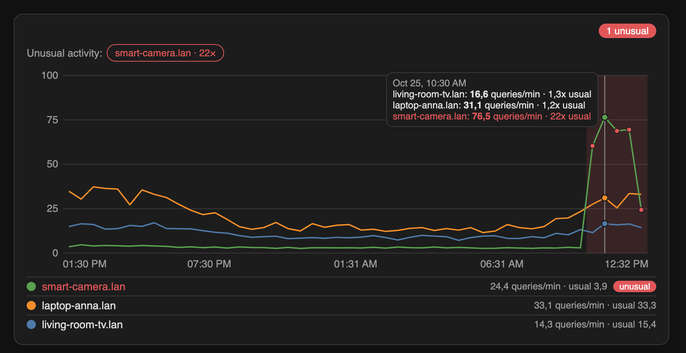
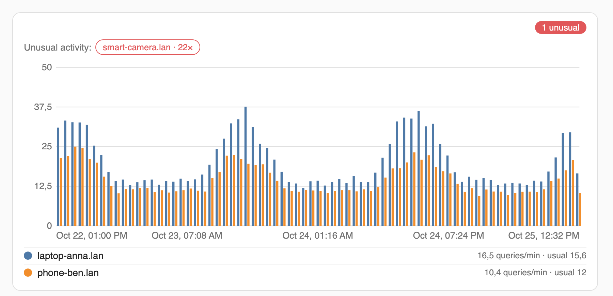

# Pi-hole Extended

[](https://my.home-assistant.io/redirect/hacs_repository/?owner=Andresako&repository=pi-hole-extended&category=integration)

[](https://github.com/Andresako/pi-hole-extended/releases/latest) [](https://github.com/andresako/pi-hole-extended/actions/workflows/hacs.yaml) [](https://github.com/andresako/pi-hole-extended/actions/workflows/hassfest.yaml)

**See which device on your network is talking to Pi-hole, and when one goes crazy.** Pi-hole Extended turns the queries Pi-hole v6 reports into per-device counters, an activity chart for your dashboards and sensors you can automate on.



> A community-built Home Assistant custom integration. It is not affiliated with or endorsed by Home Assistant or Pi-hole.

## Features

- **One Home Assistant device per client** that Pi-hole sees, with DNS query counters and allowed, blocked and provisional breakdowns.
- **Activity card** to chart one or more devices by 5-minute to 1-day blocks over up to 30 days, as lines or bars. Everything is set from the card editor.
- **Unusual-activity detection**: a device that stays far above its own usual rate is highlighted in the chart and turns on a binary sensor you can use in automations.
- **Diagnostics** for the connection, the last read, the last query seen and ingestion coverage.
- **Privacy-minded**: the integration keeps only counters, and the card and sensors use aggregate counts, never domains. Optional Activity entries do include the queried domain; choose *Totals only* to turn them off.
- Independent of Home Assistant's built-in Pi-hole integration.

## Requirements

- Home Assistant **2025.1 or newer**, with the Recorder enabled (the default).
- Pi-hole **v6**. The query API contract is checked against FTL **6.1.0–6.8.x**; each Pi-hole serves its API reference at `/api/docs`.

## Installation

### HACS (recommended)

1. Select the button at the top of this page, or in HACS open **⋮ → Custom repositories**, add `https://github.com/Andresako/pi-hole-extended` and choose **Integration**.
2. Install **Pi-hole Extended** and restart Home Assistant.
3. Open **Settings → Devices & services → Add integration**, search for **Pi-hole Extended** and follow the form.

### Manual

Download the latest release from the [releases page](https://github.com/Andresako/pi-hole-extended/releases/latest), copy `custom_components/pihole_queries` into your Home Assistant configuration directory and restart Home Assistant.

## Configuration

Create an application password in Pi-hole's web interface under **Settings**; Pi-hole shows it only once ([authentication guide](https://docs.pi-hole.net/api/auth/)). Then enter:

| Field | Description |
|---|---|
| Host or IP address | Without protocol, port or path. |
| Web/API port | Used exactly as entered. |
| Use HTTPS / Verify certificate | Turn verification off only for a self-signed certificate. |
| Application password | Stored in the integration entry and never written to logs. |
| Polling interval | 1–3600 seconds (default 15). Shorter intervals show new queries sooner and make more API requests. |

### Options

Open the integration and choose **Configure**:

| Option | Values | Effect |
|---|---|---|
| Polling interval | 1–3600 s | How often Pi-hole is read. |
| Activity policy | Activity enabled · Totals only | Whether new queries are sent to Home Assistant Activity. *Totals only* sends none. |
| Activity events | All · Blocked only · None | Which new queries appear in Activity. Counters are never filtered. |
| Unusual activity alert | Off · Low · Medium · High | Sensitivity of the card and the binary sensors. *Off* creates no sensors. Default: Medium. |

Use **Reconfigure** to change the address or credentials; choose *Same Pi-hole* to keep counters and identity, or *Replacement Pi-hole* when the server itself was replaced.

## Entities

For every client, grouped under its own device:

| Entity | Description |
|---|---|
| `sensor.phe_<client>_consultas_dns` | **DNS queries**: cumulative queries observed. |
| `sensor.phe_<client>_consultas_en_el_ultimo_minuto` | **Queries (last minute)**: rolling count by Pi-hole's query time. |
| `sensor.phe_<client>_permitidas_v1` | **Allowed queries**, cumulative. |
| `sensor.phe_<client>_bloqueadas_v1` | **Blocked queries**, cumulative. |
| `sensor.phe_<client>_provisionales_v1` | **Provisional queries**: result not yet recognized. |
| `binary_sensor.phe_<client>_actividad_inusual` | **Unusual activity**, see below. |

Per Pi-hole entry, four diagnostic sensors: **Communication status**, **Last successful read**, **Last query observed** and **Ingestion coverage**. `<client>` is the client's address with underscores, for example `192_0_2_21`; the entity registry shows the exact IDs.

The integration counts the queries it observes while polling. It does not backfill what Pi-hole handled before setup.

## Activity card

The card is loaded automatically. Add it to a dashboard with **Edit dashboard → Add card → Pi-hole Extended activity**, or paste it as a manual card:

```yaml
type: custom:phe-activity-card
```



Choose the devices, block size, range, chart type and other settings in the card editor. They are saved in the dashboard, so everyone sees the same chart. With no devices selected the card shows the three busiest. You can also write the options in YAML:

```yaml
type: custom:phe-activity-card
title: Network activity
entities:
  - sensor.phe_192_0_2_21_consultas_dns
  - sensor.phe_192_0_2_34_consultas_dns
bucket: 30m
span: 1d
chart_type: bar
log_scale: false
show_overview: true
names:
  sensor.phe_192_0_2_21_consultas_dns: Living-room TV
```

| Option | Values | Default |
|---|---|---|
| `entities` | Up to 12 **DNS queries** counters | The three busiest |
| `bucket` | `5m` `15m` `30m` `1h` `3h` `6h` `1d` | `30m` |
| `span` | `6h` `12h` `1d` `3d` `7d` `14d` `30d` | `1d` |
| `chart_type` | `line` · `bar` | `line` |
| `log_scale` | `true` · `false` | `false` |
| `show_overview` | Warn about unusual devices, including ones not in the chart | `true` |
| `title` | Optional heading | none |
| `names` | `{entity_id: label}` | the client's name |

In the legend, select a device's colored dot to hide or show it, or its name to open Home Assistant's history for that sensor. Hover the chart for a cursor and a tooltip with each device's rate and how it compares with its usual level.

The card reads Home Assistant's long-term statistics, so the time axis is when Home Assistant received the data. Blocks under one hour are available for ranges up to 10 days, the Recorder's default for 5-minute statistics.

## Unusual activity

A device is **unusual** when it stays well above its own recent pattern: several times its usual level, above its typical daily peak and above a minimum rate, for at least 15 minutes. Quiet devices and devices that burst regularly are not flagged for normal behavior, and a new device has no baseline until 24 blocks of history exist (two hours for the sensors).

Each device gets a **Unusual activity** binary sensor that is *on* while that happens, *off* otherwise and *unknown* until it has enough history (24 five-minute blocks). It is evaluated every 5 minutes, so it reacts within 10 to 20 minutes. Its attributes are `current_rate`, `usual_rate`, `threshold`, `times_usual`, `since` and `evaluated_at`.

```yaml
automation:
  - alias: Pi-hole · unusual device activity
    triggers:
      - trigger: state
        entity_id: binary_sensor.phe_192_0_2_47_actividad_inusual
        to: "on"
        for: "00:10:00"
    actions:
      - action: notify.notify
        data:
          title: Unusual DNS activity
          message: >-
            {{ trigger.to_state.name }} is making
            {{ trigger.to_state.attributes.current_rate }} queries/min,
            {{ trigger.to_state.attributes.times_usual }}× its usual.
```

Ready-to-import [dashboard](examples/dashboards/pihole-extended.yaml) and [automation](examples/automations/unusual-activity-alert.yaml) examples, and how to adapt them, are in the [examples guide](docs/dashboard-examples.md).

## Good to know

- The card and the sensors read Recorder statistics. If you restrict the Recorder with `include`, record the client sensors:

  ```yaml
  recorder:
    include:
      entity_globs:
        - sensor.phe_*
  ```

- With Activity enabled, each new query is written to Home Assistant's **Activity** (logbook) with its client, domain and result. Whether it is kept depends on your Recorder and Activity filters. Choose *Totals only* if you do not want domains in the logbook.
- At very short polling intervals, or with hundreds of clients, see [technical details](docs/DETAILS.md) for the measured limits.

## Troubleshooting

- **Counters do not increase:** check **Communication status**, host, port, TLS settings, the password and whether Pi-hole still holds the query in its in-memory history.
- **Counters increase but Activity is empty:** confirm *Activity enabled* is selected, that the events setting allows the result and that Home Assistant's Activity filters allow it.
- **The card is not listed or shows "Custom element doesn't exist":** restart Home Assistant after installing or updating and refresh the browser without cache.
- **The chart is empty:** the client needs recorded statistics; wait a few minutes after setup and check the Recorder includes `sensor.phe_*`.
- **Unusual-activity sensors stay unknown:** a device needs at least 24 blocks of recorded history (two hours for the sensors) before it has a baseline.

## Support

- [Report a problem or request a feature](https://github.com/Andresako/pi-hole-extended/issues)
- [Changelog](CHANGELOG.md) · [Technical details](docs/DETAILS.md) · [Contributing](CONTRIBUTING.md) · [Security policy](SECURITY.md)
- [Leer en español](README.es.md)

## License

[MIT](LICENSE)
